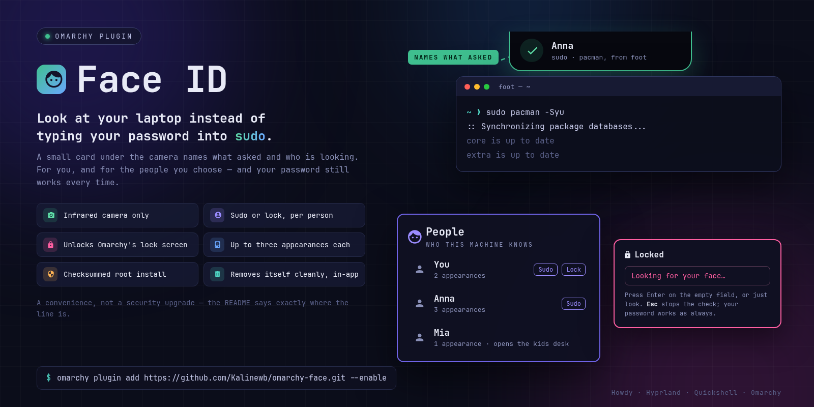

# Face ID

Look at your laptop instead of typing your password into `sudo` — for you, and for the
people you choose.

## What it is for

**Thirty passwords a day.** Updates, package installs, a file in `/etc`. With Face ID,
`sudo` shows a small card under the camera naming what asked, you glance at it, and the
command runs. Your password still works every time, and it is still what gets you past a
login screen or an SSH session.

**A family machine.** You and your partner both look after this laptop, so both of your
faces can approve `sudo`. Your kid is a person too — not for `sudo`, but so the Profiles
plugin can open their own desk when they sit down. Who can do what is a switch per
person, and only your password changes it.

**Glasses on, glasses off.** Every person has up to three appearances — no glasses,
everyday glasses, reading glasses — because an infrared camera sees those as different
faces.

**The lock screen, if you want it.** Off by default. Turn it on, lock, walk away; when
you come back, touch a key and look at the screen. Or press **Enter** on the empty
password field, any time, to ask for a face check there and then. The password field says
*Looking for your face…* while it checks, and tells you if it did not recognise you — so
you can see it working and decide whether to press Enter again or just type. Press **Esc**
while it is looking to stop the check and type your password instead. It follows Omarchy's own
lock screen as it updates, and if an update changes too much it steps aside, tells you,
and your password works as always.



## What it is, and what it is not

**It is a convenience.** It saves typing and stops someone reading your password over
your shoulder. It is not a security upgrade.

**A face is always on.** A password has to be typed and a fingerprint has to be touched.
Your face is simply there. Any program running as you can start `sudo`, and if you are
in front of the camera your face can answer before you have read what asked. The card
names the command and what started it so you can notice a request you did not make —
noticing is all it can do. Such a program could already wait for you to type your
password; face unlock removes the wait, not the permission.

**The lock screen wakes to anything.** A key, a bump of the mouse — or a program running
as you — wakes the screen and starts one face check. Enter on the empty password field
starts one too, and so can a program running as you, the same way. If you are sitting
nearby, it can open.

**Giving someone Sudo gives them root.** Everyone on this laptop uses the same account.
When Anna's face approves `sudo`, Anna runs commands as the machine's owner. The switch
says so.

**Sudo keeps a better record than the lock screen.** Every `sudo` answered by a face is
written to the system journal *by root* — whose face it was, which appearance matched, the
command that asked and what it was started from — and so is every attempt that failed. The
lock screen is written by root too, but it is a smaller claim: the daemon records
`lock verify matched: <name>` when it recognises somebody, and since it also records the
reason when it does not, a run of refusals can be read back afterwards.

What root cannot say is that the screen opened. The daemon only ever learns that a face
matched; what was done with that answer is not its business and it never finds out. The
line saying the lock was opened is written by your own session — so that part, and only
that part, a program running as you could still fake or remove.

**Names are visible on this computer.** The list of people and their display names can be
read by every account on the machine. Faces cannot. So is the record of what was last
checked and who it matched — any account can ask "is Anna at the camera right now?" and
get an answer, and can read who last approved what.

**It is not Windows Hello.** There is no secure chip. The face data and the matching code
live on this computer's disk, and anyone with root can change what "your face" means.

**A good infrared photograph of you can fool it.** It refuses to run without an infrared
camera, because a normal webcam accepts a printed picture — but an infrared image of a
face is not impossible to make.

**Your password is never replaced.** If face does not recognise you in a few seconds, or
the lid is closed, or a call is using the camera, the password prompt appears as always.

## How it works

**The engine is howdy.** Face builds it for you: howdy and a CPU-only dlib, compiled from
the Arch User Repository at the two revisions this version of Face was tested against, and
installed with `pacman`. It takes several minutes and about half a gigabyte of disk while
it runs, and it keeps going if you close the panel or restart the shell.

**Face's own half is small and readable:** seven scripts in `/usr/local/bin`, two systemd
units, one polkit action, one configuration file. They are installed from this plugin
folder, under one password dialog, and removed the same way.

**`sudo`** is wired by adding one marked four-line block to `/etc/pam.d/sudo`. Nothing
else in that file is touched, turning the switch off takes the block back out, and the
file goes back byte for byte. There is at most one face attempt per `sudo` call — a
password retry does not re-open the camera — and at most six attempts a minute across
separate calls.

**The lock screen** is a second plugin, `kalinewb.face-lock`, that holds no copy of
Omarchy's lock screen: it loads *Omarchy's own* lock code and adds a face check alongside
the password field and the fingerprint reader. It draws nothing of its own — nothing may
draw over a session-lock surface, and a plugin that tried would be defeating the one
guarantee a lock screen makes. What it does instead is write a line into Omarchy's own
password field, the same place Omarchy puts *Authentication failed*: *Looking for your
face…* while the camera is open, and *Face not recognised — use your password.* when it
was not you. Omarchy clears it the moment you start typing. If an Omarchy update renames
that field the line stops and face unlock carries on without it, never the other way
round. When Omarchy updates its lock screen, the new
one simply runs. If an update changes the names that loader depends on, face turns itself
off there and says why, and the lock screen keeps working exactly as Omarchy ships it.
Face is tried when the screen **wakes**, or when you press **Enter** on the empty password
field — never when you lock it, because locking the machine while you are still sitting
in front of it would otherwise undo itself.

Enter works through Hyprland rather than through Omarchy's password field, which a plugin
cannot reach. While the screen is locked, and only then, Face registers a Hyprland binding
on Enter, and one on Esc, that pass the key straight on to the password field and also
tell Face it was pressed. They are removed when the lock ends, and your own `bindings.lua`
is never touched. An Enter that submits a typed password is recognised as one and starts
no face check. Esc only ever stops a check that is running; it never starts one.
If Enter or Esc ever stopped reaching the password field while locked, switch to a text console
(Ctrl+Alt+F2), log in, and remove the binding:
`hyprctl eval 'for _, b in ipairs(_G.omarchy_face_enter_binds or {}) do b:unbind() end'`.

**After an update, and at login,** Face checks itself and tells you if something stopped
working, rather than leaving you to find out at a lock screen. It puts two small hooks in
`~/.config/omarchy/hooks/` — `post-update.d/kalinewb-face.hook` and
`post-boot.d/kalinewb-face.hook` — which Omarchy runs during `omarchy update` and a
moment after you log in. They read the same status the Setup view shows, as you, without
the camera and without a password, and send one notification per new problem that opens
Face ID → Setup. During an update they also catch the three things updates break: a Python
upgrade the engine was not built for, an Omarchy lock screen that no longer fits Face
(before the restart that would switch face off on it), and the AUR step that is about to
rebuild howdy or dlib away from the revisions Face tested. Nothing is printed when all is
well. If the plugin is removed, each hook deletes itself the next time it runs.

**"Who is at the camera?"** is answered by a small root daemon on a socket in `/run`, for
callers that hold no privilege of their own: the Profiles plugin and the lock screen
loader. The socket is reachable by every local process on purpose; the daemon asks the
kernel who is on the other end and answers only this account. Nothing it says
authenticates anybody — `sudo` never goes near it.

**What is stored where.** The face data lives in howdy's own model files, readable only by
root, and it is not a photograph: it is a list of numbers, and no picture of you is kept.
Display names and appearance labels live in `/var/lib/omarchy-face/people.json`, which
every account on the machine can read.

## Installing it

```sh
omarchy plugin add https://github.com/Kalinewb/omarchy-face.git --enable
```

A face icon appears in the bar. Click it and work down Setup:

1. **Install Face ID** — Setup's one button. It asks for your password once, installs
   Face's system files, and starts building the face engine by itself.
2. **Wait for the engine build** — the howdy and dlib build above. Setup shows each step
   as it goes; you can close the panel while it runs.
3. **Record your face** — People → Add person. The first person recorded on the machine is
   its owner.
4. **Give that person Sudo, or Lock screen, or both** — Person → the switches. This says
   *who may*; on its own it changes nothing.
5. **Settings → Face for sudo**, and **Lock screen** if you want it. Lock screen asks for
   your password, then hands Omarchy's lock screen over to Face's; on some bars the panel
   closes for a moment while it does, and comes back on Settings by itself. This is the other
   half, and it is the one that wires the machine: until it is on, no face is tried
   anywhere, however many people have the permission.

Both halves are needed, and that is deliberate rather than a nuisance: the per-person
switch is a list of names, and the Settings switch is the one that edits
`/etc/pam.d/sudo`. Each screen says when the other is missing — Settings will not turn on
before somebody has the permission, and the Person page says when the machine-wide switch
is off.

### Installing or updating the system files

Setup's **Install Face ID** button does this, and so does **Update Face's system files**
after a plugin update: one password dialog, nothing to copy or type. The dialog is
polkit's own and says it wants to run **/usr/bin/bash** as the super user — that is this
installer, because Face's own helpers cannot ask with their own message until they exist.

The script the button runs is printed here, as the terminal command that does the same
thing — for anyone who would rather read it first, and for a machine whose panel will not
open. It asks for your password through `sudo`:

```bash
sudo /usr/bin/bash -c 'PATH=/usr/bin; set -o pipefail; t=$(mktemp -d) || exit 1
  no() { echo "{\"error\":\"$1\"}"; }
  run() {
    [[ -f $1/system/install.sh && ! -L $1/system/install.sh ]] || { no installer_missing; return 1; }
    install -m 0600 -- "$1/system/install.sh" "$t/install.sh" || { no installer_missing; return 1; }
    p=$(curl -fsS --max-time 30 -- "https://raw.githubusercontent.com/Kalinewb/omarchy-face/refs/tags/v$3/system/install.sh.sha256") || { no checksum_unavailable; return 1; }
    [[ $p =~ ^[0-9a-f]{64}$ ]] || { no checksum_unavailable; return 1; }
    echo "$p  $t/install.sh" | sha256sum --quiet -c - >/dev/null 2>&1 || { no installer_modified; return 1; }
    bash "$t/install.sh" "$1" "$2"
  }
  run "$@"; s=$?; rm -rf -- "$t"; exit $s' \
  _ "$HOME/.config/omarchy/plugins/kalinewb.face" "$USER" 3.3.0
```

What it does, from the button or from a terminal: root copies the installer out of the
plugin folder into a directory only root can write, fetches the checksum for this release
from this repository over TLS, checks the copy against it, and only then runs it. The installer does the same for the ten files it
installs: each is copied into a root-only directory and checked against its own checksum
before anything is put in place. If the plugin folder has been changed by anything, the
check fails and nothing is installed.

**What this does and does not protect.** The bytes root executes never come from your plugin
folder — the checksum they are checked against is fetched from this release's tag over TLS,
which no program running as your account can write. `PATH=/usr/bin` at the front is part of
that: `sudo` keeps your own `PATH` unless the machine sets `secure_path`, so without it a
shim dropped anywhere on your path — `sha256sum`, `curl`, `mktemp` — would be the copy root
runs. Pinning the path means every tool comes from a directory only root can write.

What no checksum inside a script can tell you is whether the script itself is the right
one. The panel's copy lives in a file in that same writable folder, so a program that had
already taken over your account could rewrite it — and such a program could just as well
open the same polkit dialog itself, or put a `sudo` of its own on your path for the
terminal form. That is the floor of this design, whichever way you install: Face cannot
protect a password typed into an account that is already someone else's. If you have
reason to doubt the machine, read the command above and run it from a terminal instead.

The first install ends by starting the face engine build, and the Setup view shows it.

You need an infrared camera (Face refuses to work without one), and an account that can
already administer this machine — Face never grants more than the owner's password already
grants.

The engine build also needs **an internet connection**: it installs about a dozen build
packages with pacman (`base-devel`, `cmake`, `boost`, `python-opencv`, `v4l-utils` and
others) and builds howdy and python-dlib from the AUR. Removing Face takes those two back
off with `pacman -Rns`, unless you tick "keep howdy and dlib installed".

**A second plugin appears, and that is Face.** The lock-screen wrapper
(`kalinewb.face-lock`) is staged into your plugins folder the first time the shell starts
with Face enabled, whether or not you use face on the lock screen. It is what lets Face
answer the lock screen without replacing Omarchy's own; Remove takes it away with
everything else.

**Updating from 2.0.2 or earlier.** Those versions let the installed helper update itself
from the plugin folder with your own password, behind Face's own dialog. Update promptly,
and until you have, do not answer a Face ID password dialog ("Authentication is required to change who can unlock with a face") that you did not start.

### Updating from 2.x

Face ID 3.0.0 is the same plugin under a new id: `kalinewb.face`, which was
`graveklar.face` (a machine's username, where everything else of the author's says
`kalinewb`), and its lock-screen wrapper is now `kalinewb.face-lock`. Omarchy treats a new
id as a new plugin, so the move is made in steps, and none of them needs you:

1. **2.2.0**, the last 2.x release, names the new id in `shell.json` when it starts, in an
   entry Omarchy ignores until a plugin with that id is installed. Update to it first if you
   can, and let the shell restart once.
2. **3.0.0** then starts however it arrives — the notch's Plugins page, `omarchy plugin
   update graveklar.face`, or `./install.sh` from a checkout, which keeps syncing into the
   `graveklar.face` folder while that is there. It moves its folder to `kalinewb.face`,
   swaps the lock-screen wrapper in the same write that renames the ids in `shell.json` (the
   bar layout, the notch's lists, `plugins`, `disabledPlugins`, `cloneSourceRestores`) and
   in the Profiles plugin's saved profiles, and restarts the shell. Your people, your
   recordings and the PAM lines do not move: their names never had the old id in them.
3. **Face's Setup** then shows *the plugin (3.0.0) is newer than the installed system
   files* — **Update Face's system files**, one password, for the renamed polkit policy.
   The old policy file is removed only once polkit has loaded the new one.

If you went straight from an older 2.x to 3.0.0, Face is missing from the bar until your
next login or `omarchy update`, when the update and boot hooks every 2.x Face installed
finish the move; face keeps unlocking the lock screen in the meantime. Or finish it now:

```sh
~/.config/omarchy/plugins/graveklar.face/bin/omarchy-face-rename --repair
```

Anything left over — a `graveklar.face` folder beside `kalinewb.face`, or a profile that
switches the old ids back in — shows in Setup as *Face ID's rename didn't finish*, with
**Finish the rename** (no password).

Everything the move changed is kept under `~/.local/state/omarchy-face/rename/`, and one
command puts it back byte for byte, moves the folders back and restarts the shell:

```sh
~/.config/omarchy/plugins/kalinewb.face/bin/omarchy-face-rename --rollback
```

A git checkout goes back to the commit it came from (`v2.2.0` when the system files are
already 3.0.0). A copy installed with `./install.sh` has no commit to go back to: run
`git checkout v2.2.0 && ./install.sh` in your checkout afterwards.

### Updating from 3.2.x (to 3.3.0)

Face ID 3.3.0 **removes the Advanced scan**. The idle card no longer asks "Simple or Advanced": the dot scan (look at
the ball, press Space, five pictures) is the only way to record a face. This changes the system files (the enrolment
helper, root code, gets smaller: the head-turning scan and everything that served it are deleted), so Setup shows *the
plugin (3.3.0) is newer than the installed system files* and offers **Update Face's system files**, one password.
Nothing is lost by the update and **nobody has to scan again**.

**What happens to a face you recorded with Advanced.** Nothing. The record keeps its twelve (or twenty-four) pictures
and the store format is unchanged: People and Person show it as before, it unlocks the lock screen and `sudo` exactly as
before (the lock screen picks the same pictures; `sudo` still uses only the first picture), "Remove" works, and
`regenerate` and the Lock / Sudo counts in Settings read it. What is gone is the way to *make* one. To change it you
record again with the dot scan, which replaces the whole appearance with five new pictures. Until 3.2.2 the dot scan
refused to replace an appearance that held more than five pictures (so as not to shrink an Advanced set by accident); that
rule went with Advanced, because without it such an appearance could not be re-recorded at all. Pressing Re-record on one
now replaces it, after the same password, and only when you save (Esc or Cancel keeps the old pictures).

**Mixed versions, in both directions (nothing unsafe in either, and nothing is stored that you did not save).**

- *3.3.0 plugin, 3.2.x system files* (you updated the plugin and have not pressed the Setup button yet): the card works,
  because a 3.2.x helper lists the dot scan. The only difference: that helper still refuses to re-record an appearance
  that holds more than five pictures, and the card shows "Something went wrong". Update the system files and it
  works. Nothing is stored.
- *3.2.x plugin, 3.3.0 system files* (the system files were updated first): the old card's Simple scan works. Its
  **Advanced** choice (and an appearance with more than five pictures, which the old card forces into Advanced) finds that
  the helper no longer lists `sweep`; the old card then falls back to the **single capture**, with the note "Finish the
  update in a terminal for the full scan" (3.3.0 reworded the note to "Update Face's system files in Setup for the new scan"). That is the same fallback 3.2.0 had for a helper older than 3.1.0. It takes one
  centre picture after a 3-2-1; if you press Done it **replaces that appearance with that one picture**, and if you press
  Esc, nothing is stored. A `sweep` line from any other source is refused ("bad_sweep"), nothing started, nothing stored.
  Update the plugin to get the dot scan back.

**The popup opens on the home.** Closing the Face popup now forgets where you were: it used to reopen on the last view
(Settings, a person), and now every open starts from the home (*Face ID is set up*). The bar button opens the home too: on a set-up
machine it used to open People, and now People, Settings and Remove are one click below the home (a lock screen that stopped working
still opens Settings, and Face's own failures still open Setup). Esc still goes back one step before it closes. Plugin only, no password.

**What did not change.** The identity rule (0.40 and 0.55, 0.56 and 0.60 for the top picture), the runs of three and
five frames, the cap of five "That did not look like you" presses, the floor (the first picture, left and right), `sudo`
using only the first picture, and the store format. The debug trace (`debug=true`, `journalctl -t omarchy-face-sweep`) is
the dot scan's, one line per press; the tag keeps its old name so existing notes still find it.

### Updating from 3.2.1 (to 3.2.2)

One change, in root code (Setup offers **Update Face's system files**, one password): **the top pose is judged more loosely than the other four.**
Your live scan took the centre (eyes 46 px apart) and the left (0.29 from the centre) and then refused the top four times, "That did not
look like you": the up pictures sat 0.46-0.60 from the first picture (0.52, 0.60, 0.54, 0.46, the largest distance of each press), and the rule
was 0.40 to the nearest stored picture and 0.55 to the first. Three of the four presses were refused by the 0.40 rule (their frames were under
0.55 from the first picture), the second possibly by both; the fourth had three good frames but not three in a row. In three presses your face
also read 36-40 px between the eyes against the first picture's 46, and a smaller face sits farther from a bigger one's picture, so part of the
distance was your leaning back. For the **top pose only**, a picture may now be up to **0.56** from the *nearest* stored picture and **0.60**
from the first (`DOT_TOP_CHAIN`, `DOT_TOP_HARD`; the 0.60 matters only when another stored picture, such as your left, is within 0.56 of the
new one, so with only the first picture stored the reach is 0.56); left, right and bottom keep 0.40 and 0.55, and the runs (three in a row to take it, five in a
row to refuse it) and the five-refusals cap are unchanged. The lock screen takes a stored top picture up to 0.60 from the first one (and so
nothing beyond that is stored); Sudo is unchanged (the first picture only).

**It may still refuse you.** These are the tighter of the two options, chosen on purpose. Fake-camera presses of somebody whose top frames sit
0.52 or 0.54 from the first picture (frame to frame wobble of 0.02) were all taken (20 of 20); at 0.56 18 of 20; at 0.58 or 0.60 none (0 of 20),
because every frame is at or over the 0.56 bound. So the press at 0.60 in your old trace would most likely **still be refused**, and so would
one whose frames all sit above 0.56. If you still fail at the top, the next answer is a **skip** for that pose, or a **correction for how big your
face is** (leaning back made it 10-20% smaller than the first picture and pushed the distance up), not a still looser limit. Sit as you did for the
first picture, or a little closer, and the up pictures read nearer.

What it admits, honestly, because it is still the largest loosening of the top pose Face has had. In the fake-camera test (20 presses per cell,
uniform wobble of 0.08 or Gaussian 0.04 from frame to frame; no real stranger data exists anywhere in this project, so a real second person is
**not measured**), somebody whose pictures sit on average 0.46, 0.50, 0.52 or 0.54 from yours was refused every time under 3.2.1 (0 of 20) and is
**stored every time** under 3.2.2 (20 of 20; 19 of 20 at 0.54 with the wider wobble). At 0.56: 18 / 17 of 20 (uniform / Gaussian); 0.58: 12 / 5;
0.60: 4 / 0; 0.62: 0 to 1; above that none. Dlib's own default for "same person" is 0.6, so the top pose now takes lookalikes (a relative, a similar face)
up to about 0.58 from you. The other poses keep their own bounds, and a stored top picture is not used as a stepping stone for them (a right or bottom picture is judged against your first picture and the others, and against the top one only if the old 0.40 / 0.55 rule would have admitted it), so a lookalike admitted at the top cannot walk on into right and bottom. The cap of five refused presses only protects from about 0.58 up: a stranger at 0.58 still gets in in most sessions of five tries, at 0.60 in about half or fewer, and below 0.56 he is never refused. It needs your authorised session and a person in front of the camera
pressing Space, the first picture is still needed, and a stored up picture helps only the lock screen. **To revert**, tell me and the top
pose goes back to 0.40 and 0.55 (the constants are `DOT_TOP_CHAIN` and `DOT_TOP_HARD` in `system/omarchy-face-admin`).
The debug trace now says which bound refused a press (`refused_hard`: over 0.60/0.55 from the first picture, `refused_chain`: over 0.56/0.40
from the nearest stored one, `maxrun`: the longest run of good frames, `end=`: ok, run or time), so the journal answers it directly next time.

### Updating from 3.2.0 (to 3.2.1)

Two things, one of them in root code (so Setup offers **Update Face's system files**, one password).

**The ball is on the screen now.** In 3.2.0 the five stations were drawn inside the small card at the top of the screen, so looking
at "left" moved your eyes, not your head. Now the ball goes to the real screen: the middle of the screen for the first picture,
then the left edge, the top edge, the right edge and the bottom edge of the screen the card is on, 64 pixels in from the physical
edge, so you have to turn your head towards the side of the screen. It is a second, see-through window the size of that screen,
above the card, that takes no clicks and no keys (Space and Esc are still the card's); the other screens only keep their dimming.
The card shrinks to what has to be read from close up: the camera's picture, the reason a press failed, the Space key and Cancel.
The top of the screen is a few centimetres below the camera, so "look up" is a smaller turn than left or right; that is the laptop,
not the scan. Not tried on a real screen by its author (the tests draw it at five output sizes offscreen).

**"Come a little closer" at the first picture.** Your live trace had two first presses fail with every lit frame too small (62 frames,
31 lit, all `closer`, both times) and the third work at once. The limit was 40 pixels between the eyes; it is **36** now (`EYE_MIN`),
and the card says how much bigger your face has to look ("Come a little closer (about 14% bigger)") instead of only asking.

What is known, and what is not, about your seat. In the 3.1.7 live lap the eyes read 44 straight on and 39-45 while you turned,
with the turned frames reaching 39-40, so the 3.1.7 lap does not show your straight-on seat to be under 40. The only sign that it
sometimes is, is those two failed presses, and the eye size was not logged, so **how far under 40 they were is unknown**. Your
recordings are no help either: they hold only 33 lit one-face frames at 34-40 pixels (27 in the `far` one and 6 in `guided`), all taken
while the head was moving. After your first scan on 3.2.1 the debug trace settles it: with `debug=true` in
`/etc/omarchy-face/config`, `journalctl -t omarchy-face-sweep` prints `eye_lo` and `eye_hi` for every press, which is how big your face
really was. If `eye_lo` is under 36 at your seat, sit a little closer; the answer is not a lower limit.

The tradeoff, honestly: smaller faces are noisier. Pose-matched frames of the one distant recording, against the middle of its close
frames, sit 0.17 away at 56-70 pixels (p50), 0.33 at 40-46, 0.43 at 34-40 (only **4 frames**, one recording) and 0.71 at 17-30, so a
smaller face is farther from a bigger one's picture, and the stored first picture is itself a little lower in resolution when it
is formed small. Shrinking your own close-up frames to those sizes moves the descriptor by only 0.06-0.12, but that method understates
the real recording (0.22 where the real one showed 0.67, at 19 pixels), so it is a lower bound and not a measurement. For a stranger
the effect on false accepts at that size was **not measured** (no stranger data). Sudo uses the first picture only, so it is the one
place a lower minimum could weaken: the first picture can now be formed at 36 pixels instead of 40. Unlocking compares at whatever size
you sit. The security review's position: 36 can stand; do not go back to 40 (it flaps at your seat), and do not go lower.

### Updating from 3.1.x (to 3.2.0)

Face ID 3.2.0 replaces the **Simple** scan. The 3.1.x one asked you to move your head to four positions and
judged how you moved; it was too much for what it did, and one scan ended with only left and right filled and no
clear reason. Now a ball is on the card. It starts in the middle and then goes to the left, the top, the right and
the bottom. Look (or turn) towards it and press **Space**: each press takes one picture, and the ring round the ball
closes in for about a second while the camera collects several good frames of you. If it did not get a good one the
ring opens again and the card says why in a few words (*No face found*, *Too dark*, *More than one face*, *That did
not look like you*) and you press Space again. **Esc** or **Cancel** stops and saves nothing; **Done** keeps the scan.
**Advanced** (turn slowly all the way round) is unchanged, and the Simple / Advanced choice on the idle card now shows
both and which is on.

This changes the system files (the enrolment helper, root code), so Setup shows *the plugin (3.2.0) is newer than the
installed system files*: **Update Face's system files**, one password. Nobody who is already stored is touched, and you
do not have to scan again. Update the plugin and the system files together: a 3.2.0 card on 3.1.x system files
falls back to the old single capture with a note ("Finish the update in a terminal for the full scan"; reworded in 3.3.0), and a 3.1.x
card on 3.2.0 system files has its Simple scan refused ("Something went wrong"), because the helper no longer
has a Simple sweep.

What it does not do, honestly:

- **It does not measure your head.** The old scan tried to work out your head's angle from five points on your face;
  this one takes your word, because you pressed Space while looking at the ball. Pressing Space without turning
  stores a second picture of your face looking straight ahead: harmless, and no better coverage either.
- **Who counts as you is the same rule as before.** The first picture (the middle one) has nothing to be compared
  with, and anybody in front at that press becomes it. Each later picture must be within 0.40 of one already stored and
  within 0.55 of the first, the numbers 3.1.x used, for three frames in a row; five frames in a row that fail it end the
  press as *That did not look like you*, and the fifth such press of one session closes the session and saves nothing.
  Somebody within 0.40 of your first picture can still be added (the same documented limit, and a lookalike whose
  picture hovers at about 0.42 from yours, with the usual frame-to-frame wobble, still got in about one press in five in
  the fake-camera test); **enrol only yourself**. In the other direction, a picture of you that hovers about 0.40 from
  everything stored is refused about one press in four: turn a little less. The numbers come from the author's recordings
  of one person, one laptop, and the tests above use a fake camera.
- **The first picture is not checked for sharpness or steadiness.** It must be one face, lit, the right size, in
  view and with your eyes level (as in 3.1.x), and its three frames must agree with each other, but a blurred or moving
  face that still agrees can form it.
- **Sudo is unchanged.** It still uses only the straight-on picture (`SUDO_POLICY="centre"`); the four turned pictures
  are for the lock screen. They carry a fixed stand-in for "how far round" (`r` 1.6, past the limit a wider Sudo
  setting would need), because nothing here measures it.
- **Save before all five.** Once the middle, left and right are taken, a **Save** link appears for the case where
  you cannot get the last one; the helper refuses a save with less than that.
- **It has not been run against a real camera by its author.** The test suites use a fake camera and fake face
  model. If your first scan after updating misbehaves, `debug=true` in `/etc/omarchy-face/config` makes the helper
  write one line per press to `journalctl -t omarchy-face-sweep`: the pose, whether it was taken, how many frames
  were lit, unlit (the strobing emitter's off half), too dark, without a face, with two faces, too small or too big,
  or somebody else, and the largest distance from your first picture. Counts and words, never a picture.

### Updating from 3.0.0

Face ID 3.1.0 changes the system files (the enrolment helper learns the head-turning sweep
that a later release's view will use, and `set-limits`), so Setup shows *the plugin (3.1.0) is
newer than the installed system files*: **Update Face's system files**, one password. Nothing
about who can unlock changes: Sudo still uses one straight-on picture per look, and a stored
person is not touched.

### Updating from 3.1.0

Face ID 3.1.1 changes the enrolment helper in `system/` again (one fix, in root code): a strobing
infrared emitter lights every other frame, and the head-turning scan counted the black ones as the
room being too dark ("Too dark here" with the emitter visibly blinking). It now skips a fully black
frame as the emitter's off phase, as howdy itself does, and says "dark" only of a lit frame. Setup
shows the plugin is newer than the installed system files: **Update Face's system files**, one
password. Nothing about who can unlock changes.

### Updating from 3.1.1

Face ID 3.1.2 changes the enrolment helper once more (root code): 3.1.1's test for the strobing
emitter's dark frames assumed they were exactly black, and on this laptop's real camera they never are
(99.8% dark, a raw mean of about 1.5, against 27-37% dark for a lit frame), so "Too dark here" stayed.
The helper now recognises an unlit frame by being nearly all dark *and* almost without light, and says
dark of a lit frame only. It also gains an off-by-default trace for diagnosing it: put `debug=true` in
`/etc/omarchy-face/config` and `journalctl -t omarchy-face-sweep` shows one line a second during a
scan (counts and words, never a picture). Setup shows the plugin is newer than the installed system
files: **Update Face's system files**, one password.

### Updating from 3.1.2

Face ID 3.1.3 changes the enrolment helper again (root code). With "Too dark" gone, the scan still
sat on "Look straight at the circle": replaying your own recordings through the helper's real
functions showed the head-steadiness test read a *held* head as moving 96% of the time (a still
head wanders by about six degrees; the test allowed a fraction of one degree between smoothed
frames), so the centre could not be held. It now smooths over five lit frames and allows 0.20
(still head: 4% steady before, 88% after; centre held in about 2.5 s instead of never). The
off-by-default trace (`debug=true` in `/etc/omarchy-face/config`, `journalctl -t omarchy-face-sweep`)
now also counts frames that passed every gate and each gate that failed (closer, farther, edge,
dark, blurry, roll, unsteady), and prints the pose and the centre gate. Setup shows the plugin is
newer than the installed system files: **Update Face's system files**, one password.

### Updating from 3.1.6

Face ID 3.1.7 changes the enrolment helper (root code, so Setup offers **Update Face's system files**, one
password). The face model's picture of you depends on how big your face is in the camera's picture: measured on
your recordings, a face 10-20% smaller than the one the scan started with is farther from it than it should be in
nearly half of its frames, whatever the angle. Leaning back to look up, or drifting during the Advanced circle,
did that and ended scans with "That was not you". The scan now says "A little closer" or "A little farther" when
your face is more than about 15% off the size it started at, and does not count those frames against you (it
does not store them either). A stranger who takes over and HOLDS another distance gains nothing: none of his
frames is used and his scan runs out. One who ALTERNATES distances by more than 15% is not ended by the
five-in-a-row rule, because that rule counts only frames that were used, and only the per-frame test (0.40 from
a stored template, 0.55 from your first picture) stops him; the same was already possible by failing any other
gate, tilting the head past the roll limit, say. If somebody else's face forms your first picture at another
size than yours, you are told "closer" or "farther" until the scan runs out (about 54 s in Simple, 90 s in
Advanced) instead of "That was not you" after a few seconds. Enrol only yourself. The scan's debug trace (`debug=true` in `/etc/omarchy-face/config`, `journalctl -t omarchy-face-sweep`)
now prints your eye distance in pixels, so you can see how big your face is at the distance you sit at.

The same measurement explains why unlocking from a normal distance can fail when you scanned with the laptop
lifted against your face: the stored pictures are of a bigger face than the one the lock screen sees, and howdy
accepts a picture only if it is closer than 0.35. Scan at the distance you will unlock from (keep your eyes at
least about 45 pixels apart in the camera's picture; the trace prints it). Detection is not the problem
(`dev/measure-scale.py`: howdy's 320 pixels and one upsample find as many faces as 400 pixels or two upsamples), so
nothing in howdy's own settings was changed; to see them, read-only:
`sudo grep -E '^(certainty|max_height|timeout|dark_threshold) *=' /usr/lib/security/howdy/config.ini`.

### Updating from 3.1.5

3.1.5 is released (tag `v3.1.5`); its changes are described below, under "Updating from 3.1.4". 3.1.6 adds one
more. Past the point where two targets have filled in a Simple scan (four bins in Advanced), a frame over the
0.55 centre limit is now left out like one over 0.40, instead of ending the scan with "That was not you" and
discarding it: five of them since the last good frame end the scan with what you have, saved. The up and down
prompts say "a little", and the trace prints the pose behind the distances (`hm_yaw`, `hm_pitch`, the ranges).
Below that point nothing changed.

### Updating from 3.1.4

Face ID 3.1.5 changes the enrolment helper (root code, so Setup offers **Update Face's system files**, one
password) in two places, both found in your own trace. First, turning your head sideways read as tilting it down
by about three quarters of the turn, so a right turn landed outside the right target and never filled; the
position the scan reads is now corrected for that (it changes only which target a pose counts for, not who the
face is). Second, once two targets have filled in a Simple scan (four bins in an Advanced lap), a frame that does not
match your first one closely enough (over the 0.40 chain limit, whether or not it is also over the 0.55 centre
limit: you, tilted a long way, say) is no longer counted towards "That was not you". It is left out and the scan
says "A little less", and five of them since the last good frame end the scan with the two or more targets you
have, saved, in both modes (an Advanced lap then stops at the first sustained far-off stretch once four bins are
in, instead of waiting for you to press Done). Before that point the old rule stands, so a first or second target
that is far from straight on can still end the scan with "That was not you". The up and down prompts now say
"a little": the face model is very sensitive to tilt. As before, a person whose face is within 0.40 of yours is
not stopped by the scan (it compares pictures against your first one, not people), and the graceful end can keep
a stranger's template where 3.1.4 discarded the whole scan, so enrol only yourself. The ring and the caption
already show a target that is skipped (the tick stays empty and the line says "We will skip that one").

### Updating from 3.1.3

Face ID 3.1.4 changes the enrolment helper's debug trace only (root code; the same-person guard is exactly
3.1.3's). The scan now progressed but ended "That was not you". Measured with the real face model on your own
recordings (`dev/measure-guard.py`), an owner's frames at a moderate turn are up to 0.46 from the straight-on
one, which the guard's 0.40 chain limit refuses until a target fills; a sliding chain that would have let them
through was tried and withdrawn, because it admits strangers too. The off-by-default trace (`debug=true` in
`/etc/omarchy-face/config`, `journalctl -t omarchy-face-sweep`) now prints the guard's distances, the run of
refused frames and a final line when the lap ends, so the next failure explains itself. While the scan island is
up the screen behind it is dimmed. Setup shows the plugin is newer than the installed system files: **Update
Face's system files**, one password.

## The views

| | |
|---|---|
| **Setup** | one row per thing that has to be true, with the button that repairs it where a button can |
| **People** | who this machine knows, how many faces can approve `sudo`, and Add person |
| **Person** | their appearances, their Sudo and Lock screen switches, a **Test** button that asks "does it recognise you now?" and unlocks nothing, and Remove |
| **Settings** | the two places a face is accepted, why the lock screen is or is not active, and the way out |
| **Remove** | what would be taken off this machine, and the button that does it |

Every change to who Face knows, and to where a face is accepted, asks for the owner's
password: a face can never grant itself Sudo, because Face is deliberately not part of the
password dialog's own stack.

## If something goes wrong

**The lock screen does not react to your face.** Press **Enter** on the empty password
field and look at the camera: the field says *Looking for your face…*, the infrared light
comes on, and the screen opens about three seconds later. If it says
*Not recognised — Enter to retry*, the check ran and did not match; press Enter again.

Without Enter, the check starts when the screen **wakes**, so the screen has to go dark
before there is anything to wake: leave it alone for five seconds and let it black out. A
key other than Enter pressed while it is still lit does not start a check — it puts those
five seconds back to the beginning. If *Looking for your face…* never appears after Enter,
no check was started: see `journalctl --user -t quickshell` for a line saying Enter could
not be registered.

**Right after opening the lid, it says *Camera waking? Enter to retry*.** Some infrared
cameras take a few seconds to deliver pictures after the laptop resumes, and a check that
runs before then sees nothing. Face cannot tell that apart from a face it did not know, so
for fifteen seconds after a resume it says the camera may still be waking. Press Enter
again.

Your password works the whole time, and it is quicker than the check — so if you type it
straight away it wins, and the face result arrives too late and is thrown away. That is
not a fault, and with the line on screen you can now see it happen and wait a moment
instead. If the lid was closed, the camera was closed with it: open it and press a key.

**The infrared light flickers, or the check says the picture is too dark.** Many
infrared cameras fire their light on every other frame, so half of what the engine sees
is black; howdy's `dark_threshold` setting skips those frames, and Face leaves it at
howdy's default. If *every* frame is dark — `journalctl -t omarchy-face` keeps giving
"too dark" and the light next to the camera never glows — the emitter is not being
switched on at all. That is a firmware quirk on some laptops, and
[linux-enable-ir-emitter](https://github.com/EmixamPP/linux-enable-ir-emitter) (AUR
`linux-enable-ir-emitter`) is the community tool for it. Face does not install or
configure it.

**Setup says there is no infrared camera, and you have one.** Face looks for a camera
that names itself infrared, or failing that one whose formats are all greyscale — 8-bit
`GREY`, or 10- or 16-bit `Y10`/`Y16`, which are the ones the engine can read.
`v4l2-ctl --list-devices` and `v4l2-ctl -d /dev/videoN --list-formats` show what yours
offers. A camera that offers only formats such as `Y8I` or `Y12I` is refused, because the
engine would open it and never get a picture.

**You want to know what it actually did.** Every face check for the lock screen is
recorded by Face's root daemon, match or no, with the reason when it says no:

```sh
journalctl -t omarchy-face --since -10min
```

`lock verify matched: <name>` is a face it recognised. A line saying no gives the engine's
own reason — gave up, too dark, timed out. Nothing at all means no check was ever started,
which sends you back to the blanking rule above.

**Locking does nothing after the first unlock.** The menu's Lock, the key and the idle
timeout all do nothing, and `omarchy-shell lock status` says `"locked":true` with everything
else false. This is a Quickshell 0.3.2 bug: it never announces that the lock was released,
so Omarchy's lock screen goes on believing it is locked. With face on the lock screen,
Face sends the missing signal after every unlock, by face, password or fingerprint, and
`journalctl --user -t omarchy-shell` says `refreshed it` when it did. With face off the lock
screen, Omarchy's own lock still has the bug, and `omarchy restart shell` clears it until
the next unlock.

**The lock screen came back looking like Omarchy's own.** That is on purpose. If Face's
copy of the lock screen cannot run — after an Omarchy update, or a bad Face update — Face
steps aside within half a minute and Omarchy's lock screen takes over, with a notification
saying why. Nothing is lost: your password and fingerprint are unchanged, and Face ID →
Settings shows the reason.

**You are looking at a locked screen with nothing on it.** Give it thirty seconds without
touching anything: if Face's lock screen failed to start, the shell notices, hands the
screen back to Omarchy's own lock, and a password box appears by itself. If after a minute
there is still no password box, switch to a text console (Ctrl+Alt+F2), log in, and run
`omarchy restart shell` from there.

## For the Profiles plugin

Two calls, and they are the whole contract:

```sh
omarchy-face-identity list            # the names Face knows, one per line
omarchy-face-identity verify <name>   # exit 0 = that person is at the camera
```

Any non-zero exit means "not verified". Any person can be bound to a profile; they do not
need Sudo. Names never change, so a binding never silently retargets somebody else.

## Removing it

**Settings → Remove Face ID from this machine.** It lists what would go, asks for your
password once, removes Face's system files, the people, the PAM lines, the daemon and the
engine — and then, as its last step, deletes the two health hooks and both plugin folders, which is what closes the
panel and takes the button off the bar. There is a tick for keeping howdy and dlib
installed if you expect to come back.

Removing the plugin any other way leaves the system half working — face still answers
`sudo`, and nothing is lost — but it is not tidy. Left behind are the lock-screen wrapper
plugin (`kalinewb.face-lock`, below), its entries in `shell.json`, Face's own state
directory, and the whole system half. To take all of it off, install the plugin again and
use Remove.

**If the panel will not open**, because an Omarchy update broke it or the shell will not
start, the same removal runs from a terminal:

```sh
pkexec omarchy-face-admin purge
```

It handles a machine whose plugin folder is already gone. Add `--keep-packages` to leave
howdy and dlib installed. What it cannot do from there is remove the two plugin folders, so
delete those by hand afterwards if they are still present:

```sh
rm -rf ~/.config/omarchy/plugins/kalinewb.face ~/.config/omarchy/plugins/kalinewb.face-lock
```

## Licence

MIT.
